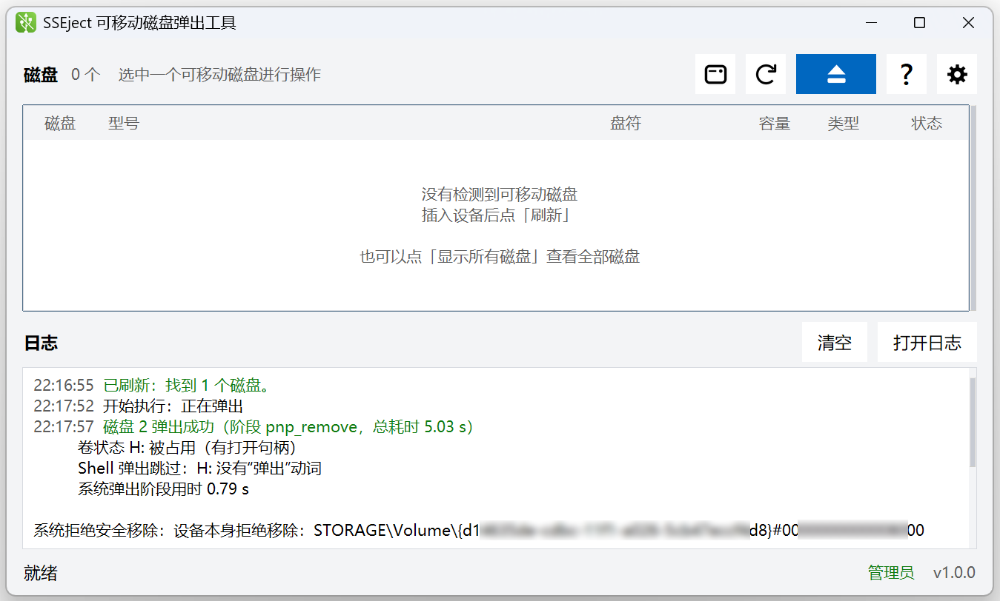
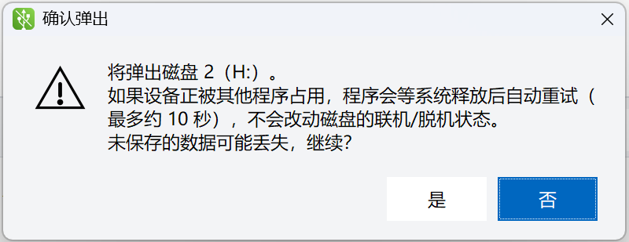
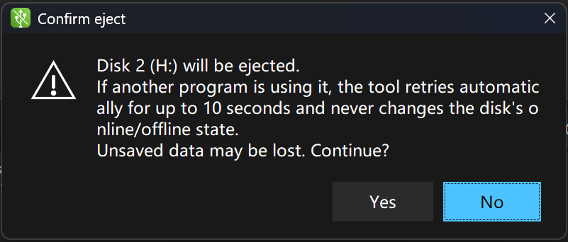
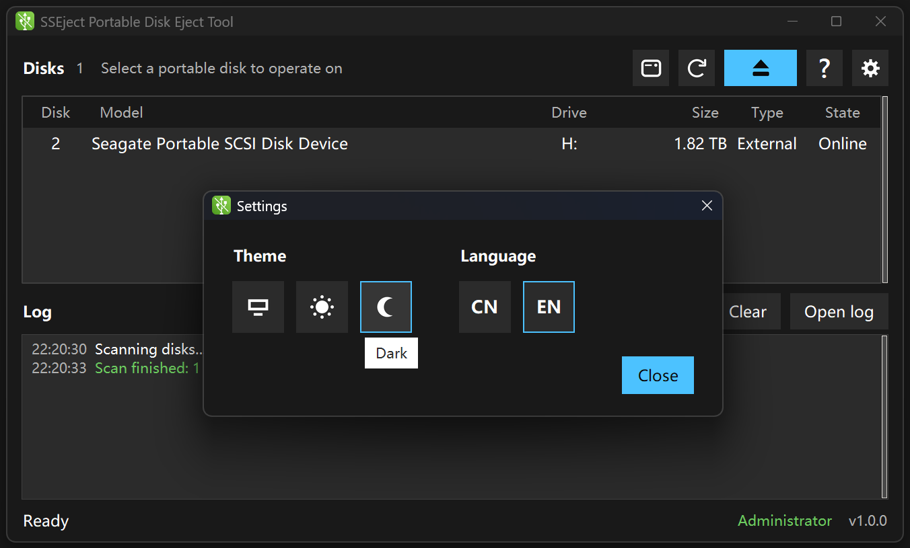

<p align="center">
  
</p>

<h1 align="center">SSEject</h1>

<p align="center">
  <strong>简体中文</strong> ｜ <a href="README.en.md">English</a>
</p>

<p align="center">
  <strong>S</strong>ure &amp; <strong>S</strong>wift <strong>Eject</strong> —— 稳、快地把可移动磁盘弹出来<br>
  选中磁盘，点一次「弹出」，看到「可以拔下」再拔
</p>

<p align="center">
  <a href="https://github.com/Neus117/SSEject/releases/latest"><strong>下载最新版</strong></a> ·
  <a href="https://github.com/Neus117/SSEject/releases">全部版本</a> ·
  <a href="#已知限制">已知限制</a>
</p>

<p align="center">
  <br>
  <sub>主界面（中文 · 浅色）：弹出成功后的日志</sub>
</p>

<p align="center">
  
  &nbsp;&nbsp;
  <br>
  <sub>确认弹出：中文界面（浅色）与英文界面（深色）</sub>
</p>

<p align="center">
  <br>
  <sub>主界面 + 设置窗（英文 · 深色）：主题与语言都在这里</sub>
</p>

---

## 它解决什么

点「安全删除硬件」时 Windows 说"设备正在使用中"，可你并没有打开任何文件——通常是后台索引、
杀毒扫描或某个系统服务还握着这块盘。SSEject 只做一件事：选中磁盘，点一次**弹出**，
它替你反复请系统放开这块卷，直到真的成功，或者告诉你卡在哪一步。

**便携绿色。** 单文件 exe，免安装、无服务、无驱动、不写注册表；不想要了，删掉 exe 和
`%LOCALAPPDATA%\SSEject` 目录就彻底干净。

> **灵感来源。** 这个工具的想法来自 [SiriusPaul 的 QuickForcedEjectPortableDisk](https://github.com/SiriusPaul/QuickForcedEjectPortableDisk)
> ——同样为解决"移动硬盘被占用、弹不出来"而写。SSEject **不是它的分支或修改版**：代码重新写过，
> 界面、弹出流水线、打包方式都不同，详见[致谢](#致谢)。

## 快速开始

1. 到 [Releases](https://github.com/Neus117/SSEject/releases) 下载 `SSEject_v1.0.0.exe`
2. 双击运行（会请求管理员权限）
3. 选中要弹出的磁盘，点「弹出」，看到日志里写 **可以拔下** 就拔掉

拒绝管理员权限也能运行：进入只读模式，磁盘照常列出，但弹出按钮置灰并说明原因。

## 功能

默认就有：

| 能力 | 说明 |
|---|---|
| 磁盘列表 | 磁盘号 / 型号 / 盘符 / 容量 / 类型（外接 · 内置）/ 联机状态 |
| 一键弹出 | 设备有 Shell「弹出」动词就先试一次；否则每 0.4 秒请求一次系统安全移除，最多 10 秒 |
| 占用检查 | 弹出前先看卷能不能被独占锁定，把"有打开句柄"和"卷还挂着"分开告诉你 |
| 分级日志 | 每个阶段的耗时、每一次否决的原始原因；可清空、可打开日志文件 |
| 失败才打扰 | 成功只在日志里记一行；失败才弹窗，并给出下一步建议 |
| 深浅色 | 跟随系统，也可在设置里固定；对话框与图标都是自绘，和主界面同一套观感 |
| 界面语言 | 默认跟随系统，可在设置里切中文 / English |

可选项（默认关闭）——**写明代价，你自己判断**：

| 开关 | 代价 | 什么时候开 |
|---|---|---|
| 显示所有磁盘（工具栏 `ALL`） | 列表里混进内置磁盘，要自己分辨 | 想确认某块盘到底是外接还是内置 |
| 主题改为浅色 / 深色 | 不再跟随系统切换 | 系统主题频繁变化，或截图、投屏需要固定一种 |
| 界面语言改为中文 / English | 不再跟随系统 | 系统语言不是你想用的界面语言 |

## 性能

口径：同一台机器、同一块 USB-SATA 机械硬盘、三次取中位数。策略对比也记在
[`CHANGELOG.md`](CHANGELOG.md) 里。

| 场景 | 结果 |
|---|---|
| **弹出（本工具：只重试）** | **4.2 ~ 4.6 s**，过程中被系统否决 2~3 次，重插后资源管理器直接可读 |
| 先脱机再移除 | 4.0 s，0 次否决，但重插后资源管理器**读不到**，要手动联机 |
| 脱机 → 联机 → 重试 | 16.9 s，10 次否决 |
| 窗口出现 | 0.80 ~ 0.87 s |
| 磁盘列表出现 | ~1.0 s（先用上次查询的快照，后台再查一遍） |
| 一次完整磁盘查询 | 1.36 ~ 1.39 s（开机后第一次 4.29 s） |

**我们慢在哪，以及为什么这么选。** 磁盘查询这一步走的是 PowerShell 的 CIM 查询
（`Get-CimInstance` + `Get-Partition` + `Get-Disk` 一次跑完），1.4 秒几乎全花在那次查询上
（进程启动只占 0.21 s）。换成原生 IOCTL 理论上能到几十毫秒——但**非管理员打不开
`\\.\PhysicalDriveN` 句柄**，而"拒绝提权后仍以只读模式列出磁盘"正是本工具的默认路径。
换过去等于给这些用户一张空列表，所以我们保留了慢一秒、但谁都看得见的那条路，
并用启动快照把等待盖住。

## 使用说明

| | |
|---|---|
| **下载** | 到 [Releases](https://github.com/Neus117/SSEject/releases) 下载 `SSEject_v1.0.0.exe`，双击即用，无需安装 |
| **权限** | 双击会请求管理员权限；拒绝后进入只读模式（能看不能弹出） |
| **文件落在哪** | `%LOCALAPPDATA%\SSEject\`：`settings.json`（主题 / 语言）、`app.log`（UTF-8 带 BOM、1 MB 轮转）、`last-disks.json`（上次查询快照，只为启动时秒出列表） |
| **开机自启** | `Win+R` → `shell:startup` → 把 exe 的快捷方式放进去 |
| **卸载** | 删掉 exe，再删 `%LOCALAPPDATA%\SSEject` 目录；没有服务、没有驱动、不写注册表 |
| **怎么看版本** | 启动后窗口右下角有 `v1.0.0`；或右键 exe → 属性 → 详细信息 |
| **诊断** | `SSEject.exe --diagnose "%TEMP%\sseject.json"` 写出一份运行状态 JSON（磁盘数、两种视图行数、语言、字号、徽标墨迹占比），出错时退出码为 1 |
| **跳过提权**（测试用） | `SSEject.exe --no-elevate` |

## 已知限制

| 项 | 状态 |
|---|---|
| 弹出需要管理员权限 | 只读模式只能查看，不能弹出 |
| 设备没有 Shell「弹出」动词 | 跳过 Shell 阶段，直接走系统安全移除；结果一致，日志里会记一行 |
| 手机、相机（MTP 便携设备） | **不支持，也不打算支持**——见下 |
| 每次磁盘查询 ~1.4 s，开机后第一次 4.3 s | 已用启动快照盖住大部分等待，日志里仍能看到真实耗时 |
| 仅 Windows 10 / 11（x64） | 更低版本未测试 |
| 日志里的历史行不跟随语言切换 | 历史按写入时的语言显示，只有新写入的行跟随当前语言 |

**为什么 MTP 设备不支持：它不是文件系统。** 手机、相机在资源管理器里是"shell 命名空间里的
一项"，不是块设备——本工具依赖的物理磁盘号、盘符、卷、设备节点在它身上都不存在，
所以"安全弹出"对它没有意义。

**你该怎么办：** 这类设备本来就直接拔（没有卷要卸载，也没有写入缓存要冲刷）。要转移文件，
先用资源管理器复制到本地磁盘，再用本工具处理那块本地盘。

## 文档

| 文档 | 面向 |
|---|---|
| `README.md` / `README.en.md` | 用户——全部功能、开关、代价、已知限制 |
| [`CHANGELOG.md`](CHANGELOG.md) | 用户与维护者——每个版本的用户可见变化 |
| [`LICENSE`](LICENSE) | 所有人——MIT，商用与修改都可以，保留版权声明即可 |

## 开发者

```powershell
# 环境：Windows 10 / 11 + Python 3.12（开发实测 3.12.15）
python -m pip install pyinstaller          # 只有构建需要；运行只用标准库 + Tk

python app.py                              # 直接跑源码
python -m unittest discover -s tests       # 36 项单元测试，不碰真实磁盘

# 构建单文件 exe（产物在 dist\）
python -m PyInstaller --noconfirm --distpath dist --workpath build app.spec

# 门禁：真跑一次磁盘查询、界面构建、徽标加载，结果写成 JSON
dist\SSEject.exe --diagnose "%TEMP%\sseject.json"
```

门禁看什么：

| 字段 | 判据 |
|---|---|
| `error` | 必须是 `null` |
| `rows` / `rows_show_all` | "只看外接"与"显示所有"两种视图各查到几行 |
| `lang_pt` | 语言按钮的生效字号（当前 11） |
| `badge_ink_ratio` | 对话框警告徽标的墨迹占比：线框版 ≈ 0.17，实心三角会 > 0.4 |
| `help_window` / `icon_handles` | 说明窗能否构建、图标句柄能否加载 |

代码结构（**分层是为了让判断可以被自动验证**）：

```
core/    查询、弹出、PNP 否决映射、diskpart、日志、i18n
         —— 不依赖 Tk；"这块盘算不算外接""失败是哪一种原因"这些判断都在这里，由 tests/ 覆盖
gui/     Tk 窗口、Canvas 自绘控件、主题与字体、自绘对话框、Win32 桥
tools/   图标与徽标的 Pillow 生成器、抓图/量测探针（不参与打包）
tests/   单元测试（36 项）
```

界面层只负责画和转发；改弹出策略、改判定规则都在 `core/` 里改，改完跑测试。

## 致谢

[**SiriusPaul/QuickForcedEjectPortableDisk**](https://github.com/SiriusPaul/QuickForcedEjectPortableDisk)
是最初的灵感来源：它同样为了解决"移动硬盘被占用、弹不出来"而写，也正是它让我开始认真琢磨这件事。

SSEject 与它**没有共用代码**，实现也不同：界面与对话框全部自绘（不是系统 MessageBox）；
弹出走"Shell 弹出动词 + 只重试系统安全移除"，而它用"脱机→联机"释放占用（本工具实测那条路更慢，
还会把盘留在脱机状态、重插后资源管理器读不到）；日志路径与打包方式也重新设计。

两个项目可以并存：需要"强制剥离占用"时可以试它的做法，需要"稳、快、不改磁盘状态"时用这个。

## 许可

[MIT](LICENSE) © 2026 Neus117

「SSEject」是本项目的名称，指 **S**ure & **S**wift **Eject**。官方渠道只有本仓库与
[Releases](https://github.com/Neus117/SSEject/releases)；从别处下载的构建请自行核对 SHA256。
