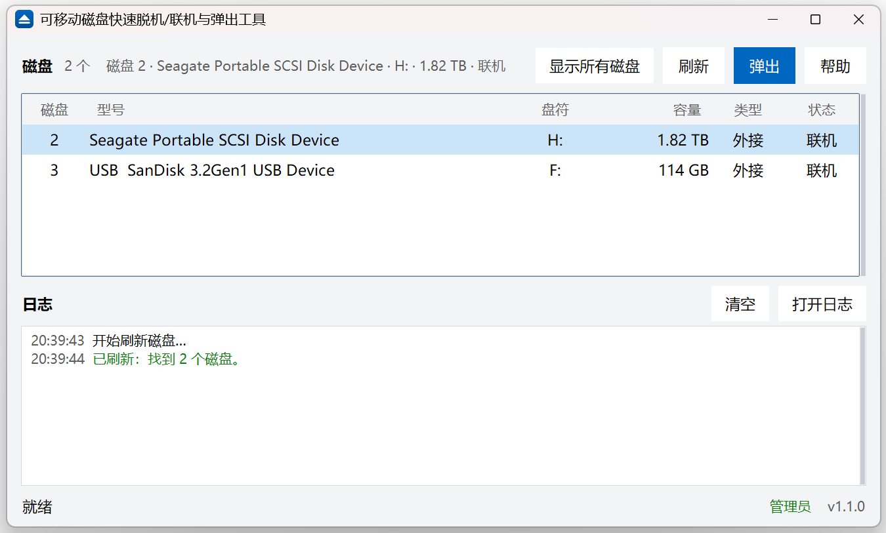

# SSEject

**Sure & Swift Eject** —— 稳、快地把可移动磁盘弹出来。

[English](README.en.md) | 简体中文



## 它解决什么

点「安全删除硬件」时 Windows 说"设备正在使用中"，可你并没有打开任何文件——通常是后台索引、
杀软扫描或系统服务还握着这块盘。SSEject 只做一件事：选中磁盘，点一次**弹出**，剩下交给它。

## 怎么做到"稳"和"快"

```
Shell 弹出（设备有“弹出”动词就试一次；没有就记住，下次跳过）
   ↓
每隔 0.4 秒请求一次系统安全移除（最多 10 秒）
   ↓
成功 → 盘符消失、可以拔下；失败 → 设备原样，说明原因
```

**关键：全程不改磁盘状态。** 不脱机、不强制卸载、不做脱机→联机——这些"帮忙"的操作实测
更慢，而且会把盘留成脱机，重插后资源管理器读不到。

同一台机器、同一块 USB-SATA 硬盘的实测：

| 策略 | 耗时 | 否决次数 | 重插后资源管理器 |
|---|---|---|---|
| **只重试（本工具）** | **4.2~4.6 s** | 2~3 | 直接可读 |
| 先脱机再移除 | 4.0 s | 0 | 读不到，需手动联机 |
| 脱机→联机→重试 | 16.9 s | 10 | 直接可读 |

## 功能

- 磁盘列表：磁盘号 / 型号 / 盘符 / 容量 / 类型 / 联机状态
- 一键弹出，占用检查与重试全自动；成功不打扰，失败才说明原因
- 日志面板：分阶段耗时、每次否决原因，可清空、可打开日志文件
- 浅色 / 深色跟随系统；自绘对话框与图标，观感统一
- 单文件 exe，免安装

## 运行要求

- Windows 10 / 11（x64）
- 弹出需要**管理员权限**；没有权限时以只读模式运行，仍可查看磁盘

## 使用

1. 以管理员身份运行 `SSEject.exe`
2. 在列表中选中要弹出的磁盘
3. 点「弹出」，看到"可以拔下"后拔掉即可

## 常见问题

- **还是提示"设备仍在使用中"**：等 3~5 秒再点一次；或关掉打开该盘的资源管理器窗口。
- **日志乱码**：日志为 UTF-8 带 BOM，PowerShell 5.1/7 的 `Get-Content` 都能正确显示。
- **诊断**：`SSEject.exe --diagnose "%TEMP%\sseject.json"` 会写出运行状态。

日志：`%LOCALAPPDATA%\SSEject\app.log`（1 MB 轮转）。

## 构建

```powershell
python -m pip install pyinstaller pillow
python tools/design_icon.py
python tools/design_badges.py
python -m PyInstaller --noconfirm app.spec
```

测试：

```powershell
python -m unittest discover -s tests -v
```

## 许可

[MIT](LICENSE) © 2026 Neus117
